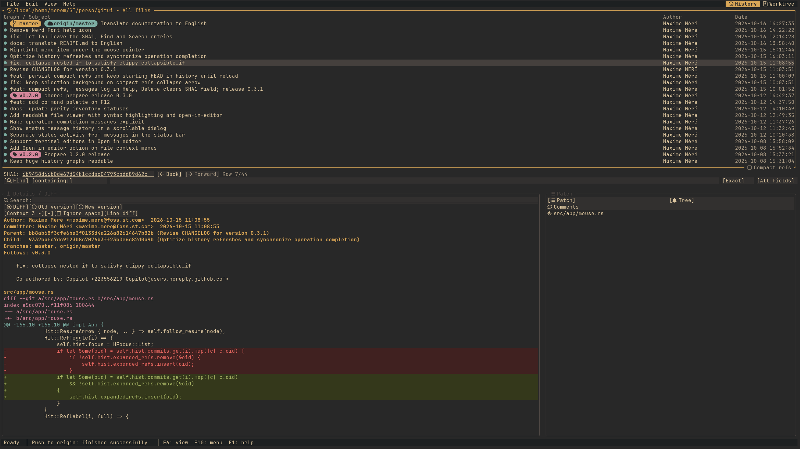

# Git Twin

Terminal Git client for Linux, with a **History** view inspired by gitk and a
**Worktree** view inspired by git gui.
**`gitt`** starts Git Twin in the History view; **`git tui`** starts Git TUI in
the Worktree view, via the **`git-tui`** executable. Both commands give access
to both views; `--view` replaces their initial view.

Version **1.0.1** provides history with
graph, branches and tags, diffs,
indexing by file/block/lines, and commit editing with a keyboard and mouse
interface. Full parity with gitk/git gui is not claimed: see the
[known limitations](docs/limitations.md), especially for advanced operations.



## Linux installation

**Without Rust**: once the release is published, download the archive
`git-twin-1.0.1-x86_64-unknown-linux-gnu.tar.gz` and its `.sha256` file from
the [official Releases page](https://github.com/meremST/git-twin/releases).
The Linux binary targets **x86_64 with glibc
2.35 or newer** (for example Ubuntu 22.04/24.04, Debian 12).
It is not suitable for Alpine/musl or ARM.
See the [installation guide](docs/build-install.md) to verify the archive,
install both commands into `~/bin` without administrator rights, and configure
`PATH`.

**From source**: install Git, a C compiler and
[Rust via rustup](https://rustup.rs/), then run from the sources of the chosen
version:

```sh
cargo install --path . --locked --root "$HOME"
export PATH="$HOME/bin:$PATH"
gitt --version
git tui doctor
```

The binaries are installed to `~/bin/gitt` and `~/bin/git-tui`.
Keep `~/bin` in `PATH` in your shell configuration.

The build toolchain is pinned to **Rust 1.93.1** by `rust-toolchain.toml`.
Rust is not needed to use the binaries. Git must be in `PATH`; the program
refuses Git < 2.25, but this floor still has to be validated on that version.
Local tests use Git 2.43. The initial distribution is through archives and
sources, not crates.io.

### Uninstallation

From the sources or the extracted archive, without `sudo`:

```sh
sh scripts/uninstall.sh --cargo  # installed with Cargo into ~/bin
sh scripts/uninstall.sh          # alternative: manual installation into ~/bin
```

Choose the command matching your installation. Configuration, drafts and
repositories are kept.

## First launch

```sh
# Start without allowing any repository modification.
gitt --repo /path/to/repo --read-only

# Open the worktree to index and commit.
git tui --repo /path/to/repo
```

Without `--repo`, the current directory is used. The application does not
create a repository if the given path does not contain one. Git Twin uses your
Git, your configuration, your hooks and your external tools: only open
trusted repositories. Read-only mode is not a sandbox.

Recommended size: **120 x 35** cells. Minimum size: **79 x 24**.
Between these sizes, compact mode shows one panel at a time, with clickable tabs
and Tab navigation. `F11` maximizes/restores the active panel.
Below the minimum size, actions are blocked: enlarge the terminal to handle a
confirmation or an error before quitting.

## Usage

In the **Details** panel, the **Tags** line shows only the tags (lightweight or
annotated) pointing at the selected commit. It is hidden if that commit has no
tag. **Follows** and **Precedes** separately indicate the neighboring tags in
the history.

History keeps space for the commit subject even when many references point to
one commit. HEAD's branch name comes first; **`+N`** opens a searchable list of
that commit's references; this popup closes when you click outside it.
**Compact refs** keeps HEAD named and groups the
remaining references into counted markers, such as `[B:2] [T:12] [R:5]`.
Click a marker to expand it. **View > Reference labels** hides categories for
the current session without filtering commits or changing the graph; HEAD
remains visible.

**F2** opens a fixed, non-modal reference browser. Click visible History
elements to select commits, scroll or open context menus while it stays open.
Click inside the browser to resume filtering; F2 focuses the global reference
list again. Escape clears a nonempty browser filter first, then closes the
browser; an open context menu closes first. Confirmations remain modal.
Clicking a tag shows its annotation with preserved paragraphs and indentation.

In Worktree, each file list has its own **Filter** field. Click it, or press
**`/` / `Ctrl-F`** while that list is focused. Matching is case-insensitive:
plain text searches the path, `*` matches any sequence and `?` one character.
**Enter / Esc** returns to the list without clearing the filter;
**Ctrl-U** while editing, or **`[x]`**, clears it. Active filters show
visible/total counts and survive rescans and view changes during the session.
Hidden files are removed from selection; **Ctrl-A** selects visible files,
and **Stage Visible** / Ctrl-I only stages visible changes.
**Commit always includes the entire index**, including staged files hidden by
the filter; the message panel displays the total staged count.

| Command | Effect |
| --- | --- |
| `F6` | Switch between History and Worktree |
| `Tab` / `Shift-Tab` | Change panel or field |
| `F10` / `Alt` + menu letter | Open menus |
| `Shift-F10` / right click | Context menu |
| `F1` | Keyboard help |
| `F12` | Command palette (fuzzy search, recent commands first, unavailable commands shown in gray) |
| `F11` | Maximize / restore the active panel |
| `Ctrl-Q` / `Ctrl-W` | Confirm if the message is non-empty, save the draft and quit |
| Drag in a diff / `Shift-Left/Right` | Select precise text for copying |
| `Shift-Up/Down` in a diff | Select whole lines for indexing |
| Wheel / `Alt-PageUp/PageDown` in a form | Scroll without changing the active field |
| Click on a file name | Select and display the diff |
| Click on the file status letter | Stage / unstage |
| `s` in the Worktree diff | Stage / unstage the selected block or lines |
| `r` in the Worktree diff | Discard changes, after confirmation |
| `Alt-4` in Worktree | Enter the commit message |
| `Alt-Enter` in Worktree | Create the commit |

Drag the separators to resize; use the wheel to scroll the panel under the
pointer. In History, the Patch list highlights the file at the top of the diff
when scrolling, or the file under the cursor/search hit when navigating lines.
The highlighted file stays visible in the list; the commit header selects
Comments. This synchronization does not change Tree selection.
`--read-only` mode also blocks fetch, push and external tools that may
modify the repository. Fine selection is reserved for copying: to index or
discard, use line selection.
The editor shows a guide at `commit_width` columns without replacing the text.
A save error is displayed; if saving fails on exit, the application stays open
and the draft remains in memory.

```sh
gitt --help
git tui -h
gitt doctor
gitt --repo /path/to/repo --no-mouse --icons ascii
gitt --repo /path/to/repo --all
gitt path/file.c
gitt --all -- src/ docs/
git tui --repo /path/to/repo --theme light --colors 256
git tui --repo /path/to/repo --theme dark --color-scheme gruvbox
git tui --repo /path/to/repo --theme terminal
```

`--all` shows the history of all refs (branches, tags, remotes), like
`gitk --all`, instead of being limited to HEAD. As with `gitk path...`, paths
given as arguments (relative to the current directory, optionally after `--`)
limit the history to commits that modify them; diffs and local change lines are
filtered the same way. The `terminal` theme uses the terminal's default and
ANSI colors: the interface follows the palette the user configured in their
emulator, instead of forcing `dark`/`light`.
It keeps the terminal background, with a yellow ANSI accent for focus and
buttons without solid fills. The selected commit inverts the background and
base text color across the whole line, with bold when the panel has focus.
On that line, colored texts use dark variants of the same family (dark green,
dark blue, etc.), suited to a light inverted background.
This dedicated palette uses RGB or 256 colors depending on `--colors`; in
16-color mode, the original ANSI colors are kept. Other selections keep their
colors on a blue (active) or gray (inactive) background.

`--help`, `--version` and `doctor` work without a repository or an interactive
terminal. `doctor` makes no network calls.
For help via Git, use `git tui -h` or `git-tui --help`:
`git tui --help` is intercepted by Git and looks for a man page that is not
provided.

Preferences are stored under `$XDG_CONFIG_HOME/git-twin`, state and drafts
under `$XDG_STATE_HOME/git-twin`, with the usual XDG fallbacks.
In **Edit > Preferences**, `Theme` selects the `dark`, `light` or `terminal`
mode. For `dark` and `light`, the `Color scheme` drop-down offers `default`
(the existing colors) and `gruvbox`: Gruvbox Dark in dark mode, Gruvbox Light
in light mode. Open the menu with Enter, Space or a click, choose with the
arrow keys then Enter, or click a color scheme; Escape closes the menu without
changing the selection. The `OK` button applies and saves the preferences;
`Cancel` discards the changes.
The `terminal` mode hides this menu and keeps the color scheme for returning to
`dark` or `light`. In `config.toml`, these choices correspond to
`theme = "dark"` and `color_scheme = "gruvbox"`; without `color_scheme`, the
`default` color scheme is kept. `--color-scheme default|gruvbox` also lets you
choose the color scheme at launch, with no effect in `terminal` mode.
The Gruvbox color scheme keeps the warm backgrounds of
[Gruvbox](https://github.com/morhetz/gruvbox), with softened accents and diff
backgrounds inspired by [Gruvbox Material](https://github.com/sainnhe/gruvbox-material).
Focus and HEAD are golden, branches sage green, remotes teal-blue and tags
mauve; light accents are darkened to remain readable on selections. The active
tab and the open menu are highlighted in solid gold. The most faithful rendering
uses `--colors truecolor`.
OSC 52 clipboard support is optional and disabled by default.

Enable **History scrollbar** in **Edit > Preferences** (`history_scrollbar = true`
in `config.toml`) to show a vertical scrollbar when the commit list exceeds the
visible area. It is disabled by default. Drag the thumb or click the track to
jump through the loaded commits of the current view; use the wheel for finer
scrolling. Scrolling does not change the selected commit or its details.
While history is loading, the range grows with the loaded commits, but stays
fixed during a drag and updates on release.

On very branchy histories (for example `gitt --all` on the Linux kernel), two
preferences keep the graph readable:
`graph_max_lanes` (20 by default, 0 = as many as the space allows) limits the
number of drawn columns; beyond that, a `…` summarizes them and the subject
remains visible. `graph_cut_after` (50 by default, 0 = never) cuts, as gitk
does, lines that have been inactive for more than N commits: the line ends in
a bold dashed `┇` and resumes as a dashed line just above the parent commit
(in a free column connected by `─╯` if the space is taken), which frees the
column (`v` / `^` in ASCII). A click on the ending dash leads to the parent
commit; a click on the resuming dash goes back up to the cut (repeated clicks:
next cut when several lines lead to the same parent).

Right-clicking a file offers “Open in editor” (History and Worktree patch
panels). The command is launched without a terminal with the file path
appended; it is set by `editor` in the configuration or in Preferences (`code`
by default, empty = disabled). Terminal editors (vi, vim, nvim, nano, hx, micro,
kak, joe, emacs -nw) take over the terminal while editing, like the tools in the
Tools window.

## Development

```sh
cargo fmt --all -- --check
cargo clippy --locked --all-targets -- -D warnings
cargo test --locked
cargo run --locked --example preview -- --demo
```

The `--demo` preview uses a temporary repository and does not modify your
repositories. Tests use temporary repositories and a pseudo-terminal.
See [status.md](status.md) for remaining work,
[design.md](design.md) for the specification,
[docs/architecture.md](docs/architecture.md) for the organization of layers,
[docs/build-install.md](docs/build-install.md) for detailed build, installation
and uninstallation,
[docs/testing.md](docs/testing.md) for the test suite and CI,
[CHANGELOG.md](CHANGELOG.md) for release notes, and
[docs/limitations.md](docs/limitations.md) for adaptations and limitations.

## License

Apache-2.0, see [LICENSE](LICENSE).
